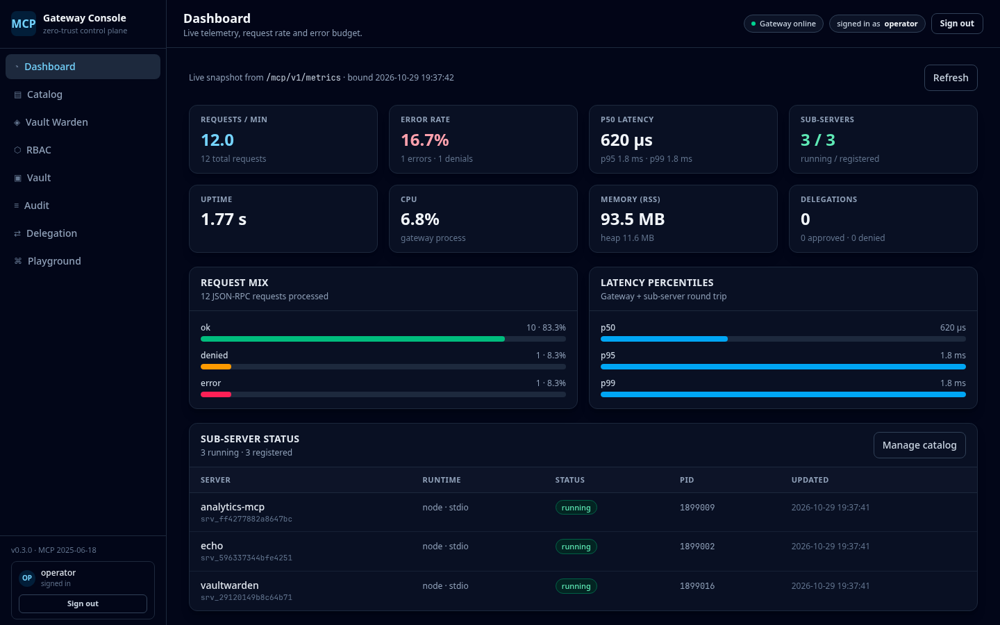
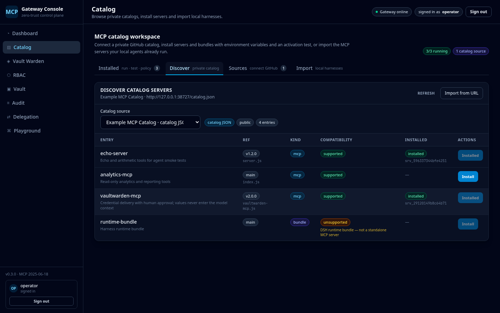

# MCP Gateway

**All-in-One MCP Gateway & Orchestration Engine** — a zero-trust JSON-RPC 2.0 proxy that fronts every MCP sub-server and remote agent harness behind one endpoint, with per-key catalog censorship, encrypted secrets, sub-agent delegation and a management console.

[](https://github.com/craigst/mcp-gateway/actions/workflows/ci.yml)
[](./LICENSE)
[](https://github.com/craigst/mcp-gateway/releases)
[](https://nodejs.org)

---

## Why

Agents calling tools directly have three systemic problems: **credential sprawl**, **tool sprawl**, and **no audit lineage**. This gateway puts one policy decision point in front of every MCP runtime (Node, Python, native binaries, remote harnesses) and answers one question per request:

> *May **this** key see and execute **this** tool, with **these** arguments, right now?*

If not, the tool is invisible — not merely denied.

## Features

| | Feature | Detail |
|---|---|---|
| 🔐 | **Scoped API keys** | `mcp_ag_`, `mcp_dev_`, `mcp_sub_`, `mcp_sup_`, `mcp_master_`; SHA-256 hashes (optional pepper), expiry, instant revocation. |
| 🕵️ | **Zero-trust discovery** | `tools/search` and `tools/list` are censored *before* serialization; unpermitted servers/tools never appear. |
| 🧱 | **Default-hidden high privilege** | `HIGH_PRIVILEGE` tools are omitted unless the key holds an explicit grant; denials return `-32001` with escalation tickets. |
| 🛡️ | **Argument guardrails** | Regex deny/require rules and JSON-Schema validation on tool arguments (e.g. allow `SELECT`, block `DROP/UPDATE`). |
| 🤖 | **Sub-agent delegation** | Expose remote observer bots as tools via `agents/delegate`; depth-capped at 3, parent-child audit tracing, approval tokens. |
| 🔒 | **Encrypted vault** | AES-256-GCM (scrypt-derived key) for API tokens / DB strings; injected into sub-process env at start; hot rotation. |
| 📦 | **Git import engine** | Clone an allowlisted repo, validate `mcp-manifest.json` **or auto-detect** the entry point, build, register, start — shell-free with timeouts. |
| 🛒 | **MCP catalog marketplace** | Connect public or **private** GitHub catalogs (`.gitmodules` + `pinned.json` umbrellas, single repos, or any catalog JSON), browse entries and one-click install/test. |
| 🔎 | **Harness import** | Read-only discovery of MCP servers already configured in Claude Code, opencode and OpenMausBot; one-click import with env-file references. |
| 🗝️ | **Vault Warden approvals** | Approval-gated credential delivery: agents request a secret, a human approves, the gateway executes once and returns a file path — values never enter the model context. |
| 🖥️ | **Web UI console** | Dashboard, catalog manager, RBAC grid, vault, audit explorer, delegation observer, live log stream, JSON-RPC playground. |
| 🔑 | **Built-in console login** | Username/password sessions (scrypt, HttpOnly SameSite=Strict cookie, CSRF protection). API keys are for AI/external clients only. |
| 📊 | **Audit everything** | Every discovery/execution/denial recorded with latency, key, tool, delegation depth and payload (truncated). |
| 🧪 | **Real tests** | Vitest unit + integration + E2E against live stdio sub-processes; CI builds the Docker image and smoke-tests `/health`. |

## Console



<details>
<summary>More screenshots (login · catalog import · discover · Vault Warden)</summary>

| Sign-in page | Catalog import |
|---|---|
|  |  |

| Catalog discover | Vault Warden |
|---|---|
|  |  |

</details>

The console signs in with a username/password session; **API keys are only for AI agents and
external management clients**. Screenshots use generic demo data (no personal configuration).

## Architecture

```
 AI agents / harnesses                         ┌────────────── Master container ──────────────┐
 (Bearer mcp_ag_…)  ── POST /mcp/v1 ─────────► │ ingress ─► RBAC policy ─► catalog (censored) │
                                               │              │                               │
                                               │              ├─► stdio supervisor ─► Node MCP │
                                               │              │                     ─► Python  │
                                               │              ├─► remote agent proxy (HTTP)   │
                                               │              ├─► AES-256-GCM vault           │
                                               │              └─► SQLite audit / traces       │
                                               │ Web UI console (React+Tailwind, /)           │
                                               └──────────────────────────────────────────────┘
```

## Quick start

### Docker (recommended)

```bash
git clone https://github.com/craigst/mcp-gateway.git
cd mcp-gateway

# Generate the two required secrets
export MCP_MASTER_KEY="mcp_master_$(openssl rand -hex 24)"
export MCP_VAULT_SECRET="$(openssl rand -base64 48)"

docker compose up -d --build
curl -s localhost:8080/mcp/v1/health
```

Open <http://localhost:8080> and sign in with the Web UI credentials
(`MCP_UI_USERNAME`, default `admin`, and `MCP_UI_PASSWORD`; when no password is set a random
one is generated and printed once to the logs). The console uses a session cookie — API
keys are only needed by AI/external clients.

On first boot (empty key table) the bootstrap master key from `MCP_MASTER_KEY` is registered;
if it is unset a random master key is generated and printed once to the container logs:

```bash
docker compose logs gateway | grep "master key"
```

### From source

```bash
npm ci
npm run build          # tsc + vite (UI bundle)
MCP_MASTER_KEY="mcp_master_$(openssl rand -hex 24)" \
MCP_VAULT_SECRET="$(openssl rand -base64 48)" \
npm start              # http://localhost:8080
```

## Import your own MCP servers

Three paths, all in **Catalog**:

1. **GitHub catalog** — connect a public or private catalog repo. Umbrella catalogs that
   pin many servers via `.gitmodules` + `pinned.json` are supported, as are single repos
   and any catalog JSON. Install runs clone → auto-manifest → build → register → test.
2. **Git URL** — paste any MCP server repository and install it directly.
3. **Local harnesses** — scan Claude Code, opencode and OpenMausBot configs read-only and
   import existing servers with one click. Environment **values** are never returned; use
   env files or supply values at import time.

Full guide: [`docs/IMPORTING.md`](./docs/IMPORTING.md).

```jsonc
// Connect a private catalog (token goes to the encrypted vault, never returned)
POST /mcp/v1/admin/catalog/sources
{ "label": "Internal MCP catalog", "kind": "dsh-umbrella",
  "repoUrl": "https://github.com/example/private-mcp-catalog", "ref": "main", "token": "ghp_…" }

// Then browse and install
POST /mcp/v1/admin/catalog/install
{ "sourceId": "cat_…", "entryId": "example-mcp", "start": true, "test": true }
```

### Vault Warden

Dangerous Vaultwarden tools are approval-gated: an agent call returns
`-32004 ESCALATION_REQUIRED`, a human approves it in **Vault Warden**, the gateway executes
the stored call once and stores the result, and the agent retrieves it with the ticket.
Deliveries are short-lived `0600` file paths — secret values never enter the model context.

## Run persistently with rootless podman (Linux)

The gateway runs happily as a systemd user quadlet, surviving reboots:

```bash
# 1. Secrets (0600). Generate strong values:
install -d -m700 ~/.config/mcp-gateway
cat > ~/.config/mcp-gateway/gateway.env <<EOF
MCP_DATA_DIR=/data
MCP_MASTER_KEY=mcp_master_$(openssl rand -hex 24)
MCP_VAULT_SECRET=$(openssl rand -base64 48 | tr -d '\n')
MCP_UI_USERNAME=admin
MCP_UI_PASSWORD=$(openssl rand -base64 18 | tr -d '\n=')
MCP_AUTOSTART=all
MCP_GIT_IMPORT_ALLOWED_PREFIXES=https://github.com/
EOF
chmod 600 ~/.config/mcp-gateway/gateway.env
podman build -t localhost/mcp-gateway:0.3.0 .

# 2. Quadlet unit
cat > ~/.config/containers/systemd/mcp-gateway.container <<EOF
[Unit]
Description=MCP Gateway
After=network-online.target

[Container]
ContainerName=mcp-gateway
Image=localhost/mcp-gateway:0.3.0
PublishPort=8080:8080
Volume=%h/.local/share/mcp-gateway/data:/data:Z
EnvironmentFile=%h/.config/mcp-gateway/gateway.env
UserNS=keep-id
NoNewPrivileges=true

[Service]
Restart=always
TimeoutStartSec=300

[Install]
WantedBy=default.target
EOF

# 3. Start + start on boot
systemctl --user daemon-reload
systemctl --user start mcp-gateway.service
loginctl enable-linger "$USER"
```

`MCP_AUTOSTART=all` (or `name1,name2`) starts catalogued sub-servers after each boot, so the
gateway is ready for agents without manual clicks. `systemctl --user status mcp-gateway`.

## Connect to the DeepSeek Harness (DSH)

DSH's `@deepseek-ai/dsh-mcp-client` can point straight at `/mcp/v1` over Streamable HTTP, so
every tool the key may see appears as `mcp__gateway__<tool>`:

```yaml
- insert:
    - id: mcp-gateway
      name: "@deepseek-ai/dsh-mcp-client"
      config:
        serverName: gateway
        transport: streamable-http
        url: http://127.0.0.1:8080/mcp/v1
        headers:
          Authorization: "Bearer mcp_master_…"   # AI/external API key
        toolCallTimeoutMs: 120000
        failOnStartupError: false
```

Restart DSH after adding the row (MCP rows are read at profile load). Full guide:
[`docs/DSH.md`](./docs/DSH.md).

## Use it from an agent

```bash
KEY="mcp_master_…"
curl -s localhost:8080/mcp/v1 \
  -H "Authorization: Bearer $KEY" -H 'content-type: application/json' \
  -d '{"jsonrpc":"2.0","id":1,"method":"tools/search","params":{"query":"echo","limit":5}}'
```

```jsonc
{"jsonrpc":"2.0","id":1,"result":{
  "tools":[{"name":"echo","description":"Echo the supplied text back to the caller",
            "server_id":"srv_…","tool_id":"srv_…:echo","score":5}],
  "total":1,"censored":true}}
```

Issue a least-privilege agent key (master key required):

```bash
curl -s localhost:8080/mcp/v1/admin/keys/create \
  -H "Authorization: Bearer $MASTER" -H 'content-type: application/json' \
  -d '{"name":"reporting-agent","keyType":"agent",
       "serverGrants":[{"serverId":"srv_…","tools":["echo"]}],
       "delegationAllowed":false,"escalationAllowed":true}'
```

The response contains `plaintext` **exactly once**. Then execute directly:

```bash
curl -s localhost:8080/mcp/v1 -H "Authorization: Bearer $AGENT_KEY" \
  -H 'content-type: application/json' \
  -d '{"jsonrpc":"2.0","id":2,"method":"tools/call","params":{"name":"echo","arguments":{"text":"hi"}}}'
```

See [`docs/API.md`](./docs/API.md) and [`docs/API-V2.md`](./docs/API-V2.md) for the complete
JSON-RPC + admin API, [`docs/IMPORTING.md`](./docs/IMPORTING.md) for catalogs/harnesses and
[`docs/MANIFEST.md`](./docs/MANIFEST.md) for the sub-server manifest format.

## Repository layout

```
src/
  core/        config · types · ports · errors · logger · SQLite schema
  gateway/     HTTP ingress · JSON-RPC router · supervisor · stdio/http transports · audit
  rbac/        key service · policy decision point · guardrails · escalations
  catalog/     tool registry · censored search · permitted server menu
  delegation/  observer proxy · depth limiter · traces
  vault/       AES-256-GCM secret store
  git_engine/  clone · manifest · timed build · registration
  admin/       REST management API
  ui/          React + Tailwind console (built to ui/dist)
tests/         unit · integration · e2e · fixtures
docs/          PLAN.md · API.md · MANIFEST.md · extracted spec
```

## Testing

```bash
npm test               # unit + integration + live stdio sub-process E2E
npm run typecheck      # tsc --noEmit
npm run lint           # eslint
npm run build          # server + UI bundle
```

The suite is **581 tests across 49 files**: unit suites per module, an integration suite that
boots a real gateway on an ephemeral port and spawns fixture MCP servers, and an end-to-end
scenario covering vault → git import → catalog → execution → delegation → depth guard → escalation,
plus jsdom UI tests. CI also builds the Docker image and smoke-tests `/health` inside the container.

## Security

- Every request is authenticated; API keys are stored only as SHA-256 hashes.
- The console uses scrypt-hashed passwords and HttpOnly `SameSite=Strict` session cookies;
  cookie-authenticated writes are same-origin checked.
- The catalog is filtered server-side before serialization (no client-side trust).
- Denials for invisible tools are indistinguishable from unknown tools.
- Sub-processes run unprivileged inside the container; build/clone URLs are allowlisted.
- Secrets are encrypted at rest with AES-256-GCM and never returned by the API.

Read [`SECURITY.md`](./SECURITY.md) for the full threat model and disclosure process.

## Status

| Release | Scope | State |
|---|---|---|
| v0.1.0 | Core engine, JSON-RPC ingress, RBAC/zero-trust catalog, UI, delegation, vault + git import | ✅ shipped |
| v0.2.0 | Private GitHub catalogs, harness discovery/import, auto-manifest detection, approval-gated Vault Warden, UI marketplace | ✅ shipped |
| **v0.3.0** | **Built-in username/password Web UI login, session-authenticated console + WebSocket logs, master-key rotation, persistent podman/systemd deployment** | ✅ **current** |

## License

[MIT](./LICENSE) © 2026 Craig CXS
